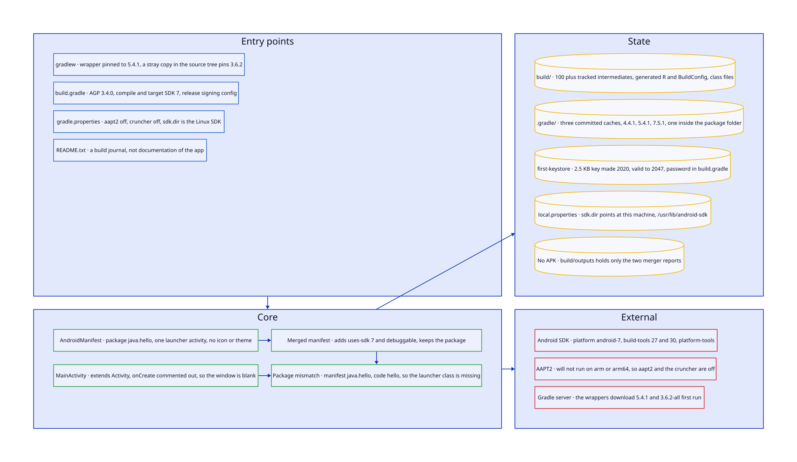

# HUMANS

A first Android app that is really a build rig: AGP, the SDK, the wrapper and a keystore wired together, with an empty Activity at the end of it.

## Read it left to right

- **There is almost no app here.** `MainActivity` extends plain `Activity` and its whole body is commented out — no `onCreate`, no `setContentView`. `Greeter` and `HelloWorld` (the plain-Java hello-world toys) are commented out too; their `.class` files in `build/classes/java/main/hello/` are leftovers from when they still compiled. What the two 2022 commits actually contain is the scaffolding: `build.gradle`, the wrappers, `local.properties`, a keystore and a README that is a build journal.
- **`README.txt` is the real documentation, and it trails the build.** It walks through `apt install android-sdk`, dropping command-line tools into `/usr/lib/android-sdk/cmdline-tools/latest`, unzipping Gradle 7.5.1 into `/opt/gradle`, and `sdkmanager "platforms;android-7"` plus build-tools 27.0.3 and 30.0.3. It quotes `classpath 'com.android.tools.build:gradle:3.1.0'` as "this line inside build.gradle" — the file actually says **3.4.0**. It also suggests finding the plugin version with `gradle buildEnvironment`, which is the honest workflow here: the Gradle, AGP and build-tools triangle is what everything else is about.
- **The app cannot start, for two independent reasons.** The manifest declares `package="java.hello"` while the sources are in package `hello`, so `.MainActivity` resolves to `java.hello.MainActivity`, a class that does not exist in the APK; and even with the package fixed, the Activity has no `onCreate`, so it would show a blank window. There is also no `res/` directory at all — icon, label and theme are commented out of the manifest, which is why the merged manifest in `build/intermediates` carries none of them.
- **Everything is committed, including the parts that should not be.** Three `.gradle` project caches (4.4.1, 5.4.1 and 7.5.1), the entire `build/` tree of intermediates and merged manifests, `local.properties` with `sdk.dir=/usr/lib/android-sdk`, and `first-keystore` — a 2.5 KB PKCS12 private key (alias `aliaslol`, 2020, valid to 2047, subject all "Unknown") whose password `nopasslol` sits in `build.gradle` and is wired to the release build type. Fine for a scratch repo, worthless as a published signing identity.
- **Two wrappers, two Gradle versions.** The root `gradlew` pins 5.4.1; a second complete wrapper lives at `src/main/java/hello/gradlew` and pins `gradle-3.6.2-all`, with its own `.gradle` cache inside the Java source package folder. `javac` ignores both, so they are dead weight, but running that copy produces a different build than running the root one. The one deliberate setting in `gradle.properties` is `android.enableAapt2=false`, with `cruncherEnabled`/`useNewCruncher` off in `build.gradle`: AAPT2 will not run on arm or arm64, and this repo is the record of working around that.

---
Diagram source: [`docs/system.d2`](docs/system.d2) · render with [`scripts/render-diagram.sh`](scripts/render-diagram.sh) (writes `docs/system.svg` and `docs/system.png`).
